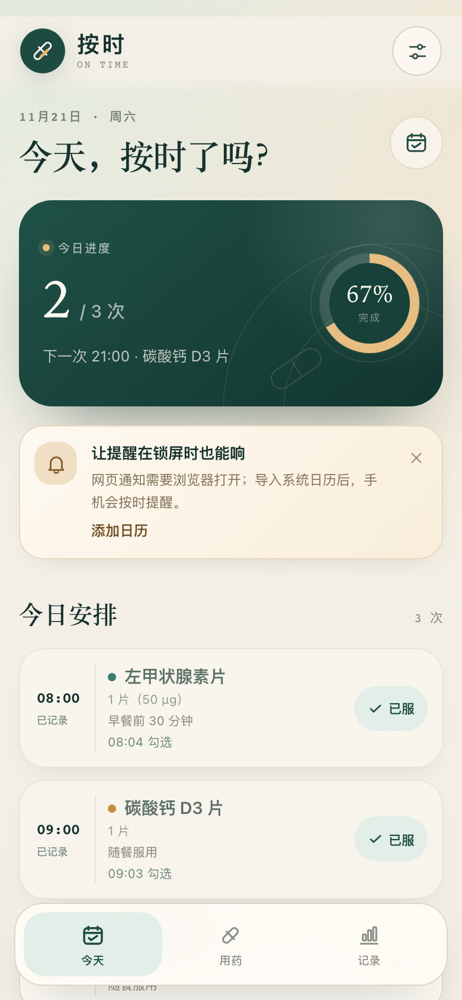

# 按时 · 每日服药提醒

一个**手机优先、数据留在本机**的每日服药提醒与打卡应用。

**在线使用：<https://henryhe-ccm.github.io/ontime-med-reminder/>**

GitHub 仓库：<https://github.com/HenryHe-CCM/ontime-med-reminder>

不注册账号、不依赖服务器、不做小程序审核。核心方案是：

> **「按时」负责计划和打卡；系统日历负责真正准点的提醒。**

网页通知只在页面运行时较可靠；导入系统日历后，锁屏、切后台也能由手机提醒。两者配合，既保持实现简单，又解决“忘了到底吃没吃”的问题。



## 已实现的功能

- 自定义药物：名称、每次用量、备注、颜色标记。
- 不同用药方案：
  - `qd` 每日一次
  - `bid` 每日两次
  - `tid` 每日三次
  - `qid` 每日四次
  - `q8h` 每 8 小时
  - `q12h` 每 12 小时
  - 完全自定义的提醒时间
- 每种药可设置 1–6 个每日提醒时间，切换频次会自动填入常用时间，之后可逐项调整。
- 开始日期、结束日期、暂停/恢复用药。
- 今日清单按时间排序，自动显示待服、已到时间、已服状态。
- 手动勾选后记录实际时间；支持撤销、恢复。
- 重复服药保护：同一种药当天已在另一个时间勾选过时，会再次确认，避免误点导致重复记录。
- 浏览器通知：开启权限后，页面运行时可收到通知；可发送测试提醒。
- 系统日历提醒：一键生成 `.ics`，每个药物时间对应一个带提醒的每日重复日程，支持 iOS/Android 系统日历。
- 近 7 天完成率、连续完整天数、每日明细；旧计划或已删除药物的打卡，会以“旧计划记录”保留在明细里。
- 本地备份导出/导入、清空数据。
- 可安装为 PWA，离线打开；重新联网时自动更新缓存。
- 数据只写入浏览器 `localStorage`，没有上传接口。

## 快速开始

### macOS 本机

双击 `start.command`，或在终端执行：

```bash
cd "med-reminder"
python3 -m http.server 4173
```

打开 <http://127.0.0.1:4173>。

### 手机临时访问

手机和电脑连接同一个 Wi-Fi，在电脑终端执行：

```bash
cd "med-reminder"
python3 -m http.server 4173 --bind 0.0.0.0
```

然后在手机浏览器打开 `http://电脑局域网IP:4173`。

> 局域网 `http` 访问可以正常添加药物、打卡、导出日历；但浏览器出于安全限制，通常不允许在非 HTTPS 环境安装 PWA 或发送网页通知。手机上建议直接使用“加入系统日历”作为可靠提醒。

### 部署成真正可安装的 PWA

这是一个纯静态站点，把整个 `med-reminder` 文件夹部署到任意 HTTPS 静态托管即可，例如：

- GitHub Pages
- Cloudflare Pages
- Netlify / Netlify Drop
- Vercel
- 任意支持 HTTPS 的静态服务器

部署后用手机打开：

- **iPhone**：Safari → 分享 → 添加到主屏幕 → 从主屏幕打开 → 设置中开启通知。
- **Android**：Chrome 菜单 → 安装应用 / 添加到主屏幕。

安装后可以离线打开，数据仍保存在该设备的浏览器内。

## 每日使用

1. 在「用药」中添加药物，填写每次用量，选择频次和提醒时间。
2. 在设置里开启浏览器通知，并点击“测试提醒”。
3. 点“加入系统日历”生成 `.ics`；在下载或分享面板中**用系统日历打开并添加**。
4. 确认系统日历的通知和声音已开启。
5. 每次服药后回到「按时」，点该次右边的「打卡」。
6. 若点错，点「已服」可撤销；提示条里也可以撤销。

> 改了药物或时间后，要重新生成日历文件，并在系统日历中删除旧的「按时」日程，避免重复提醒。

## 提醒方案为什么这样定

| 方案 | 问题 |
| --- | --- |
| 微信小程序 | 需要 AppID、服务器和订阅消息授权；订阅消息也不能保证每次自动送达，整体比这个需求复杂。 |
| 原生 App | 需要开发、签名、上架或自行安装，维护成本高。 |
| 纯网页通知 | 页面关闭后无法保证定时触发，锁屏提醒不可靠。 |
| **PWA + 系统日历** | 当前选择：页面负责计划和打卡，系统日历负责可靠的本地提醒；无账号、无服务器。 |

### 注意边界

- 浏览器通知**不是后台闹钟**。页面完全关闭后，不能保证准点响；因此一定要用系统日历作为兜底。
- 系统日历只负责提醒，不会替你勾选。提醒和打卡是两个动作。
- 日历文件是一次性导入的日程；日程内容更新后需要重新生成和清理旧日程。
- 应用不发送短信、邮件或自动拨打电话。若要做到“没打卡就自动打电话/发短信”，需要后端、短信/语音服务商和费用，不属于简单本地方案。
- 数据保存在浏览器本地，未加密。共用手机或清理浏览器数据时要注意；换设备前请导出备份。
- 清理浏览器数据会丢失记录。建议在设置中定期导出 JSON 备份。
- 本工具只辅助记录和提醒，不提供用药建议，也不替代医嘱。如果不确定是否已经服过药，请先查看记录，不要自行补服或加倍，具体以医嘱或药师建议为准。

## 数据与文件

```
med-reminder/
├── index.html              # 应用界面
├── styles.css              # 样式
├── app.js                  # 状态、提醒、日历、备份
├── manifest.webmanifest    # PWA manifest
├── sw.js                   # 离线缓存 + 通知点击
├── icons/                  # PWA / iOS 图标
├── start.command           # macOS 本地预览启动脚本
├── README.md
└── preview/                # 界面预览截图
```

本地存储键：

- `ontime.medication.v1`：药物、打卡记录和设置。
- `ontime.alerts.v1`：当天已经弹出过提醒的记录，用于防止重复打扰。

备份格式为 JSON，包含 `app`、`schemaVersion`、`exportedAt` 和完整的 `data`。导入时会校验并覆盖当前数据。

## 浏览器支持

- iOS Safari 16.4+（通知能力要求安装到主屏幕；系统日历提醒不受此限制）
- Android Chrome / Edge 现代版本
- 桌面 Chrome / Edge / Safari 现代版本

界面使用原生 `<dialog>`、`dvh`、`:has()` 等现代能力；建议使用近两年的浏览器。系统日历导入不依赖浏览器能力，兼容范围更广。

## 开发

没有构建步骤、没有第三方依赖：

```bash
python3 -m http.server 4173
```

修改 `app.js` / `styles.css` 后刷新即可。若浏览器已经缓存 Service Worker，可在开发者工具 Application 面板清除站点数据，或提升 `sw.js` 中的 `CACHE_NAME` 版本号。

## 可以继续加的

- 基于后端推送的短信、邮件或自动电话提醒
- 家庭成员共享 / 代打卡
- 药物库存与补药提醒
- 按周几、隔日、疗程递减等更复杂的方案
- 加密云同步、导出 PDF 就诊记录

其中语音电话/短信涉及第三方服务与费用；如果确实需要，建议在“系统日历”之外单独增加，而不是把这个本地应用复杂化。
